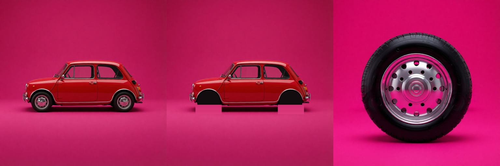
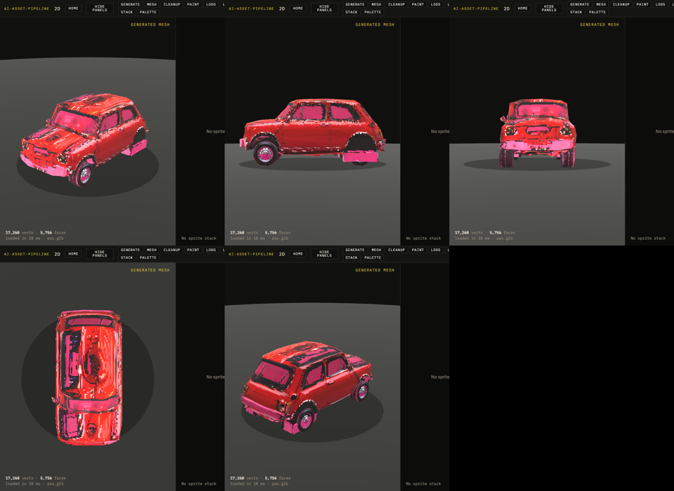
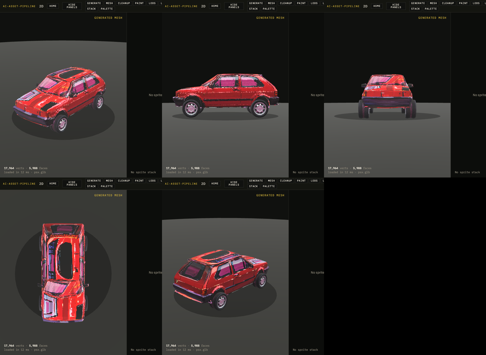

# pipeline

A local, no-cloud asset factory on Apple Silicon (MLX). Give it a picture and/or words; it makes a PS1-budget model, a
painted 3D model, a sprite stack or a 2D sprite sheet, and can rig animals and people. No Meshy. It was built for the
MLG Farming PS1-look test game (s&box). Where it stands and what is next: **[PLAN.md](PLAN.md)**.

Two ways to drive it, one factory underneath:

- **The desktop app** (`desktop/`): Home asks *What are you making?*, Make runs it, Library lists assets by project,
  and each asset goes **Ideas → Concept → 2D / 3D / Rig / Stack → Export**. See *One flow* below.
- **The workbench** (`scripts/workbench/`): an MCP server where Claude makes, measures, fixes and shows assets, guided
  by [`scripts/workbench/playbook.md`](scripts/workbench/playbook.md). See *MCP* below and **[examples/workbench.md](examples/workbench.md)**.

```bash
scripts/generate.sh --image in/mlg/farmer_hat.jpg --quality psx --stem farmer   # photo -> PS1 model
```

## How one make runs

A photo is a *reference*, never a view: the factory draws four views of the subject (from your photo, or from words),
then builds from those.

1. **isolate** — Vision foreground mask (`bin/lift-subject`).
2. **draw** — four views of the subject (front, left, back, three-quarter) from the photo or the words (Qwen-Image-Edit).
3. **shape** — Hunyuan3D-2mv from the drawn views (`shape_mv.sh`); from front and back when only the sides are drawn wrong. Without the views, the shape falls back to Hunyuan3D-2 mini from one picture and is marked degraded.
4. **reduce, remesh** — the 80k lookdev mesh, then AutoRemesher quads (`mesh_quad.glb`) so xatlas isn't packing triangle soup.
5. **paint** — Hunyuan RGB (`--quality textured`), Paint 2.1 PBR (`--quality pbr`), or TRELLIS.2 (`--paint trellis`; its plain paint gets the drawn eyes and snout via `--flat-paint`).
6. **retexture** — fit a camera to each view, bake the photo into the UVs per triangle; occluded texels keep the paint.
7. **psx** — the PS1 cut (about 1,200 triangles, a 256 px atlas): welds near-duplicates, caps holes, keeps legs and ears.
8. **review** — before a model is shown, `scripts/workbench/review.py` checks pieces, paint patchwork, mirror and triangle budget, and writes a close-up sheet.
9. **rig** — animals and people: skeleton, learned skin weights, library clips, FBX for s&box (see *Rigging*).
10. **stack, export** — horizontal slices of the painted mesh → `out/<stem>/stack/`; Export writes the chosen files and an `asset.json` to `out/<stem>/export/`.

The older People/Props routes (`m2m_keep.py` and `m2m_bind.py` for Mesh2Motion clips on AniGen skins, `articulate.py` piece pivots) are still in `scripts/` but are not the main path.

```bash
scripts/bootstrap.sh draft
scripts/generate.sh --image in/radio-concept.jpg --quality draft --stem radio
python3 -m http.server 8765 --bind 127.0.0.1
# http://127.0.0.1:8765/viewer/?asset=radio
```

Qualities: `draft` (mesh only), `textured` (RGB atlas), `pbr` (albedo + metallic-roughness), `stack` (textured then sprite-stack — the game-ready product), `psx` (PS1 low-poly: ~1,200 flat-shaded triangles wearing the photo itself in a 256 px atlas, `out/<stem>/psx/` + `psx.glb`; see **[examples/mlg-psx.md](examples/mlg-psx.md)**). Every generate also writes `out/<stem>/stack/` unless you pass `--no-stack`.

Sprite stack is how we ship. Hunyuan meshes stay in the folder as the sculpt; the stack is the lowered-fidelity volume you actually put in a game. Inspector: `viewer/?asset=<stem>` (mesh left, stack right). Default display is 120 texels / 1.20 contrast+saturation; the sheet is 160². Paint in the inspector is a local brush (not Hunyuan): it writes `stack/sheet.png` and `textured_paint.glb`.

Poly: `--poly hero` (octree 256), `lookdev` (octree 128 → 80k), `game` (octree 64 → 12k), `proxy` (octree 64 → 2k). That is the shape's detail at make time; `scripts/reduce.sh <stem>` re-cuts only the lookdev mesh and the model list.

```bash
scripts/m2m_keep.py out/operator/anigen.glb -o out/operator/anigen_keep.glb
scripts/m2m_bind.py out/operator/textured.glb -o out/operator/m2m.glb
```

Grok workflow: `/ai-asset-pipeline` with `args.image` and `args.quality`, run from the repository root (`args.factory_root` points it elsewhere).

HTTP (loopback, curl): `.venv/bin/python scripts/factory_http.py` then the copy-paste commands in **[examples/curl.md](examples/curl.md)** (`/health`, `/inspect/radio`, `POST /generate`, `/glb/radio`). `POST /generate` also takes `"mesh"` (a `.glb` under `out/<stem>/`, used as the shape instead of hy3d's) and `"paint": false` (unwrap instead of paint; only the photo bakes).

MCP: the agent workbench, where Claude makes, measures and fixes assets, lives in `scripts/workbench/` as its own server on `:8768`, a client of the factory: `.venv/bin/python scripts/workbench/mcp_server.py`, then `claude mcp add --transport http workbench http://127.0.0.1:8768/mcp`. Tools and a walkthrough: **[examples/workbench.md](examples/workbench.md)**.

## Layout

| path | what |
|---|---|
| `scripts/generate.sh` | image → GLB facade |
| `scripts/shape_mv.sh` | multi-view Hunyuan-2mv when a vendor backend is present |
| `bin/hy3d` | Hunyuan3D CLI (MLX-Swift, gitignored build) |
| `weights/` | checkpoints, gitignored, `bootstrap.sh` downloads |
| `in/` | source images |
| `out/<stem>/` | per-asset products, gitignored |
| `viewer/` | local Three.js inspector |
| `viewer/` | inspector: mesh left, sprite stack right |
| `scripts/sprite_stack.py` | mesh → `out/<stem>/stack/` |
| `scripts/pixel_views.py` | the pixel art sheet's four drawn views → true pixel art in `out/<stem>/flat/pixel/` (one shared palette, one colour per cell, sizes checked), again without the model. The sheet itself is drawn by `POST /2d/draw` with `"views": "pixel"` and an optional `"size"` (the sprite's length in pixels, 16 to 256, default 32; the prompt asks for it and the cleaner cuts at it) and an optional `"style"` (`"pixel"`, the default, or `"clean"`: the same sheet asked for as clean digital game art with no pixel wording, still cut at `size`) (top, side, front, back on magenta; `scripts/flat2d/pixelart.py`). With `"stack": true` the same job then carves the stack (`scripts/stack_views.py`, a "Carve the stack" stage) and saves it as a new Stack version made from the concept; with no `"prompt"` it draws the asset's own description (`flat/prompt.txt`). The app's Stack stage does this with **Draw views & stack** and a cells-long size (32 to 256, clean style). Pictures of the first car in [docs/pixel-views/](docs/pixel-views/) |
| `scripts/stack_views.py` | four pixel art views (top, side, front, back in `out/<stem>/flat/pixel/`) → `out/<stem>/stack/`, no mesh; in the app as the Stack stage's **Draw views & stack**, which draws the views first. Try it: `python3 tests/fixtures/views_car.py out/views-car/flat/pixel && python3 scripts/stack_views.py --stem views-car`. Carve rules in the script's header; pictures in [docs/stack-views/](docs/stack-views/) |
| `scripts/stack_building.py` | a building as a sprite stack from three drawn walls (a plain wall, the same wall with a front feature added, and optionally one with a back feature) instead of a four-view sheet, whose views disagree for buildings: the walls are fitted and cut to the plain wall's box (`flat/views/`, `views.json` layout `"walls"`, the drawn walls in `flat/walls/`), cleaned into `flat/pixel/` in one of two looks (`"crisp"`: few colours and a hard outline; `"smooth"`: each cell the average of its pixels), then built in code: a block, a deck inside a parapet, and an awning wedge out of the front where the front and back differ across the whole width. The window bays found on the plain wall can be dropped or repeated (`wide`, `deep`), so one drawing makes a wide shop or a narrow, deep townhouse; the door's bay is always kept once (the door is found as the opening that reaches the ground on the front or back; the middle bay when none is found) (`stack.json` `"maker": "walls"`, `"look"`; the app shows it as pixel art). No model: `python scripts/stack_building.py --root R --stem S --walls DIR [--look crisp\|smooth] [--size N] [--awning auto\|yes\|no] [--wide N] [--deep N] [--roof flat\|gable] [--ridge across\|along] [--roof-colour slate\|tile\|shingle\|green\|#rrggbb] [--render turned.png]` (DIR holds `base.png`, `front.png`, optional `back.png`; size 16 to 256, default 160). The walls are drawn by `POST /2d/building` (a job in the draw slot: `/status`, `/cancel`, times in `draw-times.json` under `walls:<still>+<edit>`): `{"stem", "wall": words for the plain wall, "front": the edit that adds the front (e.g. "Add a shop front to the ground floor of this building: ... and a dark green fabric awning across the top of the ground floor"), "back"?: the edit for the back, "look"?: "crisp" (default) or "smooth", "size"?: 160, "seed"?: moves the default seeds 12/23/33, "wide"?, "deep"?: window bays across the front and along the side, 1 to 12, default as drawn, "roof"?: "flat" (default) or "gable", "ridge"?: "across" (parallel to the front, default) or "along" (the gable faces the street), "roof_colour"?: slate (default), tile, shingle, green or "#rrggbb"}`; the text-to-image model draws the plain wall, then the edit model adds the front and back. A front that names an awning fails the job, with no stack written, when none is found. A gable roof (`roof: "gable"`) replaces the deck and parapet: courses of shingles or tiles in code, eaves past the walls, and gable ends filled with a windowless patch of the plain wall. No rooftop pieces yet |
| `scripts/stack_join.py` | buildings already made (their current stacks) joined into one stack, no model: `"row"` (left to right, walls touching, fronts in line: a street of shops, a shop beside a taller neighbour) or `"corner"` (a main building and a wing turned to face the side street behind it: an L). A part may be turned in quarter turns (`stem:1` faces right). Where parts meet, the first placed keeps its cells. `python scripts/stack_join.py --root R --stem S --layout row\|corner PART[:TURN] PART[:TURN] ... [--render turned.png]`; writes `out/<stem>/stack/` (`"maker": "walls"`, `"shape": "joined"`) as a new Stack version |
| `PLAN.md` | what works and what is next |

## One flow

Home asks **What are you making?**: a PS1 model, a 3D model, a sprite stack or a 2D sprite. Each shows only its own settings and a line saying what Make will do; the choice is saved with the asset (`out/<stem>/intent.json`), and the stages, canvas and Export screen follow it. The loading screen lists the factory's real stages (`STAGES`/`STAGE` lines from `generate.sh`, parsed by `/status`), with Cancel and Run in background. The desktop app runs every asset through **Ideas → Concept → 2D / 3D / Stack → Export**. A prompt with no picture draws a grid of ideas; **Use** one and it becomes the concept still that 2D, 3D and the stack start from. Each stage keeps takes in `out/<stem>/takes/` (listed in `flow.json`), so you can step back to an earlier still, sheet, mesh or stack from the bar above the tools. **Export** copies the picked 2D pieces and motion strips, sprite stack and 3D files into `out/<stem>/export/` with an `asset.json` that says what each file is. See **[docs/unified-pipeline.md](docs/unified-pipeline.md)**.

## Hard-surface props (cars, wheelbarrows, mailboxes)

Props are the weak class. There is no route that makes a clean one on its own:

- **Code-built props are gone.** Claude writing a Three.js page that becomes the model was removed (PR #8); it was not useful.
- **Plain image-to-3D works but is blocky.** A prop made like an animal (draw views, Hunyuan3D shape, paint, PS1 cut) comes out with handles, spokes and wheels hard to read (the wheelbarrow was the test). It is still the way to make a mailbox, a barrel or a crate, where blocky is fine.
- **A car is made from parts (experimental, run once on 2026-11-16).** Anything that needs its wheels to turn is made as a body and one wheel, then assembled. It runs end to end and gives a recognisable car with four separate, spinnable wheel nodes, but it is rough and needs hand-tuning per car (see below). Vehicles and props are not rigged.

```
.venv/bin/python scripts/draw_parts.py out/car/parts body_side "<a car, pure side view, no wheels>" 2   # two stills
.venv/bin/python scripts/strip_wheels.py <car.png> out/car/parts/body_nowheels.png --wheel-out out/car/parts/wheel.png --debug out/car/parts/wheels_found.png   # body without wheels, and one wheel, both in code
scripts/generate.sh --image out/car/parts/body_nowheels.png --quality psx --stem car_body
scripts/generate.sh --image out/car/parts/wheel.png --quality psx --stem car_wheel
.venv/bin/python scripts/assemble_car.py --body out/car_body/psx.glb --wheel out/car_wheel/psx.glb --out out/car/car.glb \
    [--drop -0.2 --track -0.05]          # body height and wheel spread are set by hand
.venv/bin/python scripts/viewer_shots.py car out/car/shots   # five angles and a contact sheet; needs out/car/psx.glb and a one-line lods.json
```








What the run showed (a small red retro car, 5,756 triangles, about 4 minutes to draw two stills, about 6 for both shapes and paints):

- **It works:** a body and one wheel become `car > body, wheel_FL, wheel_FR, wheel_RL, wheel_RR`, the right wheels turned so the hub faces outward, one shared wheel mesh and texture, PS1 sampling.
- **The image-edit model would not take the wheels off the body picture** (five tries, two wordings, wheels unchanged). The first run painted black wheel wells over them by hand instead, and the pink background left in the patch became slabs under the bumpers. `scripts/strip_wheels.py` now does it in code (pipeline#5): it cuts the car out, finds each tyre as the part of the car's lower edge that hangs below the underside, fills the wheel well dark above the underside and cuts everything below it away, and sets the car on one flat ground colour. Nothing is left under the bumpers to become a slab. The same script crops the wheel out of the picture (`--wheel-out`), because the image-edit model could not be trusted to pull a wheel out either: on the second run it handed back the whole car. `edit_part.py` stays for other edits.
- **Paint is speckled** (the shape came from one side picture, `single_view` in `degraded.json`) and the body's wheel wells do not line up exactly with the wheels; the stance (`--drop`, `--track`, `--axle`) was set by eye.
- Fixed while running: `assemble_car.py` assumed the body's length ran along Z, but a body made from a side picture runs along X, so the car came out 7.5 m by 3.5 m. It now takes `--body-yaw` (default 90).

So a car is possible, not push-button. Making more props means making each a picture-by-picture job, or accepting the blocky single-model result. Not in scope: rigging vehicles, and any prop with moving parts other than wheels.

## Rigging

The **Rig** stage (after 3D) gives a model a skeleton and animation clips: pick a body plan (or let the local planner
pick from the picture), press **Rig it**, and play the clips on the model. `scripts/rig.py` does the work:

- Mesh2Motion's CC0 template for the body plan (person, four legs, many legs, bird), posed like generated models
  stand and placed on the mesh (`vendor/mesh2motion-app`).
- skin-tokens.cpp on Metal learns the skin weights onto that skeleton (`vendor/skin-tokens.cpp`, MIT weights).
- The template's library clips are retargeted onto the rig and baked into `out/<stem>/rigged.glb`.
- Blender writes `out/<stem>/rig/<name>.fbx` with every clip for s&box (FBX, at most 4 weights per vertex).

`POST /rig/<stem>` runs it as a job. Busts, vehicles and props aren't rigged yet. Setup and measurements:
**[docs/spikes-rigging.md](docs/spikes-rigging.md)**.

## 2D lane

Separate from the mesh factory. Open `viewer/flat/index.html` (link **2D** in the viewer bar). The factory on port 8766 has to be running.

Drop a picture on a flat background, then Split. That keys the corner color (or magenta, after Generate) and writes `out/<stem>/flat/parts/`. Name each crop and write how it moves or what it fires. Save writes `mechanics.json`. Reopening the page reloads that sheet. Touching limbs stay one part.

Generate uses Qwen-Image 2.1 Turbo (`Qwen/Qwen-Image-2.1-Turbo`) through mflux 0.20 or later, sampled on the 8 fixed steps the checkpoint ships in `model_index.json`. The weights (about 33 GB) download on the first run. The transformer is quantized to 8 bits but the text encoder stays bf16, so plan on about 30 GB of unified memory. `FLAT2D_STILL=z-image` switches back to Z-Image Turbo, which is lighter; an older mflux without Qwen-Image 2.1 also falls back to it. `FLAT2D_QWEN` overrides the repo id. Qwen-Image 2.1 weights are under the Qwen Research License: research and evaluation only, commercial use needs a separate license from Qwen. A generated still is prompted onto magenta `#FF00FF`, subject first, and `key.json` records the magenta it was actually drawn on (sampled from the border). Split cuts a generated still with Apple Vision (`bin/lift-subject`), keeps the key only for big pieces Vision missed, and turns ground seen through clear glass back into transparency. Make one object per picture: the prompt asks for a single object with no shadow, floor, glow or other effects, because those are what break the magenta pull. A still whose ground comes back cloudy or holds a shadow is redrawn on a new seed, up to twice, keeping the flattest; Qwen-Image does this on roughly 4 seeds in 10. Pieces that touch stay one piece. A still with one object is saved as that object's cutout. Names typed for Split go to pieces left to right, then row by row. Draft stays off until `FLAT2D_LLM_URL` is set. Sound writes a stand-in wav until Stable Audio 3 Small SFX weights are present and `FLAT2D_SFX_CMD` is the runner (`prompt`, then output path). If the weights are there and the command is not, Sound stays off. Speak reads the part's line with Kokoro (`mlx-community/Kokoro-82M-bf16`, American English, voice `af_heart` unless the sheet picks another) through `mlx-audio` and writes `out/<stem>/flat/voices/<id>.wav`. Install it in the factory venv with `uv pip install --python .venv/bin/python -r requirements-voice.txt` (`mlx-audio` and `misaki[en]`, which Kokoro uses to turn text into phonemes). `FLAT2D_KOKORO` overrides the repo id. A SAM 2 miss is reported; it does not silently fall back to the color key. No API key is read.

Weights live in `weights/flat2d/` (`sam2`, `stable-audio-3-small-sfx`), gitignored. Override a folder with `FLAT2D_SAM_DIR`, `FLAT2D_SFX_DIR`, or the root with `FLAT2D_WEIGHTS`.

## What this is not

Apple has no generative 3D SDK. Object Capture (`PhotogrammetrySession`) is a separate reconstruction lane for real objects with many photos. This pipeline is the hallucinated-from-one-image (or a short turnaround) lane.

## License

MIT for this repository's own code and docs; see [LICENSE](LICENSE). The models it downloads keep their own licenses, listed in [NOTICE](NOTICE). In particular, the Hunyuan3D weights are under the Tencent Hunyuan Community License, which is not open source and does not cover the EU, the UK or South Korea.
