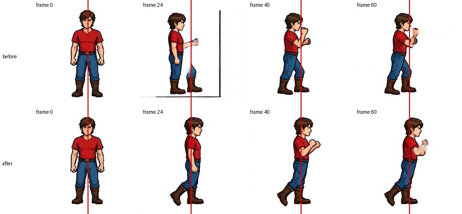
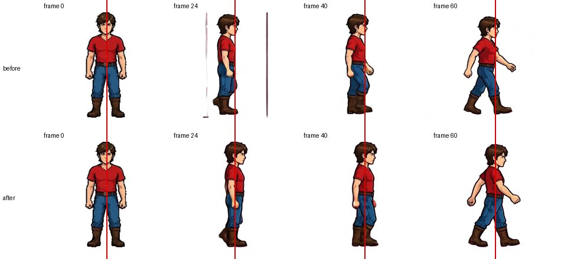

# Why LTX-2.3 walked the walker off the skeleton, and the fix

pipeline#33, 2026-11-28, MACBOOK-STEPHEN. pipeline#30 (`animate-principles-ltx.md`) found that LTX moves the walker
8–14% of the frame to the left during the turn and keeps it there.

## The cause: a drawn border in the side view

Animate gives LTX the asset's own side view as a second guide at frame 24 (pipeline#26). The walker's side view
(the pixel sheet's `flat/views/side.png`) carries a panel border: a black line down one side and along the foot.
`fit_side` stands the side figure on the front picture's spot by finding the character's box. With Apple Vision's
cut-out (`bin/lift-subject`) that box is the figure alone. Without it, Animate falls back to "what stands off the
ground colour", and that counted the border as body. The box's middle was then the middle of figure plus border,
so the figure itself was pasted at **0.33** of the frame width, where the skeleton stands at 0.50.

LTX follows the guide. The read-back body's middle is already left by frame 8, reaches 0.32–0.41 at frame 24, and
stays there. The border lines are drawn into the clip as well.

pipeline#30's runs (and pipeline#30's scratch root) had no `bin/lift-subject` (`anim.json` `cutouts: key`), so they
took the fallback. A checkout set up with `scripts/bootstrap.sh` builds `lift-subject`, and with it the old code
already centred this side view (0.499).

## The fix

- `scripts/animate.py` `_figure_box`'s fallback leaves out long thin straight lines before taking the box
  (`_drop_lines`: a run along at least half the frame that is at most 2% thick, plus a few pixels round it for its
  soft edges). On the walker's side view the fitted figure now stands at 0.497, with no border in the guide.
- Every Animate run now says how far the body stands from the skeleton: `anim.json` `pose_check.drift`
  (`skeleton.drift`: the mean x of the torso's joints, read back against given, after the turn, in percent of the
  width; mean, mean size and the worst frame).

## Before and after

Seed 42, the principled cycles made for the walker's own rig, its own side view mirrored to face right, 73 frames,
704 px, LTX-2.3 distilled q8 with the Union-Control IC-LoRA. Before: pipeline#30's clips. After: the same run on a
scratch copy of `out/walker`, first without `lift-subject` as pipeline#30 ran, then with it.

| clip | pose_check all joints % | moving joints % | drift after turn, mean % | mean size % | worst frame % |
|---|---:|---:|---:|---:|---:|
| before: punch (pipeline#30) | 10.96 | 10.94 | -9.35 | 9.35 | -14.83 |
| before: walk (pipeline#30) | 10.48 | 11.39 | -6.82 | 6.82 | -7.93 |
| after: punch | **7.56** | 8.55 | -0.19 | 0.80 | -2.62 |
| after: walk | **6.09** | 6.24 | -1.02 | 1.02 | -2.16 |
| after, with lift-subject: punch | 8.29 | 10.00 | +0.18 | 0.64 | -1.90 |
| after, with lift-subject: walk | 6.02 | 6.14 | -0.95 | 0.95 | -1.87 |

Drift: frames 17–72, negative is to the left. Every frame after the turn is now within 2.7% of the skeleton's
middle. pose_check falls by about 3.4 (punch) and 4.4 (walk) points; what is left is mostly the body's proportions,
which pipeline#34 fits.

The clips, their `anim.json`, the run and report scripts are in `out/_experiments/pipeline-33-drift/` on
MACBOOK-STEPHEN (`run.sh`, `report.py`, `report.md`; not in git), with the four after clips beside them.
