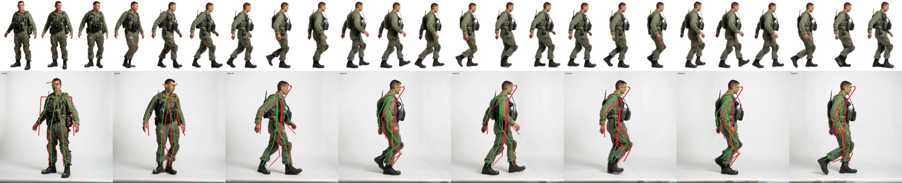
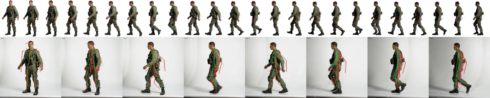
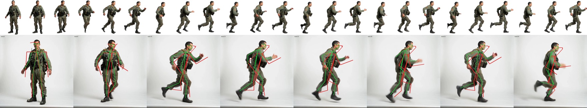
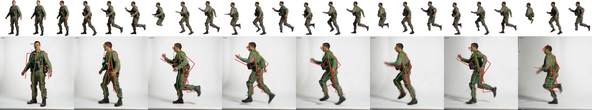
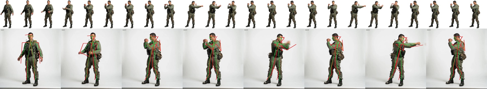
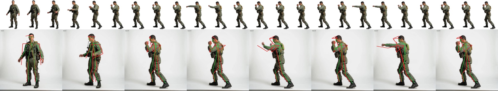

# Animate with the walker's walk, run and attack skeletons, on the operator

pipeline#18, 2026-11-24, MACBOOK-STEPHEN. Each of the six skeleton cycles from pipeline#14
(`scripts/skeletons/walker_<walk|run|attack>_<right|left>.json`) was run through the Animate stage
(`scripts/animate.py`, LTX-2.3 distilled 1.1 q8 with the Union-Control IC-LoRA) with the operator as the picture.
Every run finished; the pose_check (Apple Vision's skeleton read back from the clip, against the control skeleton,
in percent of the frame's width) and the strip of each are below.

## How it was run

- **Picture:** the operator at 704×704 on a white studio ground (`video-trials/clips/operator-704.png`, the same
  picture as the video trials), as `out/operator/input.png` in a scratch asset. Animate used it unchanged.
- **Skeletons fitted to the picture, not the picture to them.** The walker skeletons are framed for a character 82%
  of the frame tall with its neck at 0.305 and feet at 0.858. The operator stands taller (neck 0.232, feet 0.850 by
  Vision). Each skeleton was scaled by **1.117** about x = 0.5 and moved so neck and feet lines meet the operator's
  (`y' = 1.117 (y − 0.858) + 0.850`, `x' = 1.117 (x − 0.5) + 0.5`). All joints stay inside the frame (x 0.050 to
  0.950, y 0.098 to 0.850). The shipped files were not changed.
- **Proportions do not match and no move or scale fixes that.** The walker is a short-legged figure: hips at 0.637
  against the operator's 0.479, shoulders 0.24 wide against 0.15. This mismatch is in every number below; it is
  most of the ~4.6–6% error the runs show while the operator is still standing (frames 1–8).
- **Prompt:** "Side view. A soldier in a green flight suit with a radio on his chest and black boots turns to face
  <right|left> and <walks on the spot … / runs on the spot … / raises his fists and throws a straight punch to the
  <right|left>, then pulls back to his guard>, always seen from the side in profile, staying in the centre of the
  frame. Static locked-off camera, full body visible from head to boots, plain white studio background, even soft
  lighting." Seed 42, 73 frames at 24 fps, 704 px, strip of every 3rd frame (24 cells), cut-outs by Apple Vision.
- Actions are named `walk-right` etc.: Animate refuses `_` in an action name.

## Results

| Skeleton | pose_check: all joints | moving joints | frames 1–8 (standing) | turn (1–16) | cycle (17–72) | LTX time |
|---|---|---|---|---|---|---|
| walk right | **7.34%** | 7.48% | 6.24% | 6.65% | 7.54% | 85 s |
| walk left | **7.16%** | 7.31% | 6.09% | 6.37% | 7.38% | 100 s |
| run right | **8.94%** | 9.41% | 6.43% | 7.47% | 9.36% | 167 s |
| run left | **11.79%** | 16.60% | 6.18% | 8.10% | 12.84% (moving 18.66%) | 96 s |
| attack right | **10.20%** | 10.72% | 6.60% | 8.38% | 10.72% | 162 s |
| attack left | **9.87%** | 12.38% | 6.01% | 7.26% | 10.62% | 124 s |

Vision found a skeleton in all 73 frames of every run. For scale: the video trials' Wan walk skeleton on this same
picture was 1.8%, pipeline#14's own runs of these cycles on a pixel-art adventurer 7.1% (attack right) to 11.2%
(run right).

## The look of each

Each picture: the sprite strip on top; below, frames 0, 8, 16, 24, 32, 40, 52 and 64 with the control skeleton in
red and the skeleton Vision read back in green.

### Walk right: 7.34%, the best looking

A clean side-on walk facing right: full strides, heel to toe, arms swinging, the radio and boots kept. The turn from
facing the camera is smooth (frames 0–16). Usable as a strip as it is.

### Walk left: 7.16%

Turns and walks facing left as asked, steady strides. Fine detail drifts a little (the radio becomes a pouch and a
cable). The legs follow the control closely; the arms swing less than the skeleton's.

### Run right: 8.94%

A real run facing right: knees high, arms pumping, both feet off the ground in some frames. Limbs blur at speed.
The body leans more upright than the skeleton, and the strides are shorter than the red legs.

### Run left: 11.79%, the weakest

Runs facing left with the arms pumping, but the far arm reaches forward more than the control and the stride is
short (moving joints 16.6%, 18.7% in the cycle). **Three of the 24 strip cells are broken:** in frames 19, 46 and 64
the motion blur on the legs makes Vision's cut-out drop the legs, so the cell is a floating torso. The strip needs
those cells dropped or the cut-out redone before use.

### Attack right: 10.20%

The operator raises his guard and throws two straight punches (around frames 25 and 50), but **stays nearly front-on
the whole clip**, three-quarter at most, where the skeleton is in side profile. The legs keep the front stance and do
not step into the punch. Reads as "boxer facing the camera", not as a side-on attack.

### Attack left: 9.87%

Turns to face left, takes a side-on guard and throws two straight left jabs (around frames 25–28 and 49–52) that reach
the skeleton's full extension. The stance stays put. A good attack strip; its error is mostly the arm on the punch
frames running ahead or behind the control by a frame or two.

## What this says

- Walk is ready on a realistic character, both ways. Run works but the faster limbs blur, which costs both the pose
  check and the cut-outs (run left). Attack works facing left; facing right the model kept the operator front-on.
- The standing error (~6% in frames 1–8) is the walker's proportions against the operator's, not motion. A skeleton
  refitted to the operator's own limb lengths (hips, shoulders, legs) would remove it; moving or scaling cannot.
- Each run is one seed. Attack right and run left may come out better on another seed; not tried here.

## Where the runs are

On MACBOOK-STEPHEN only (`out/` is not in git): the pipeline-18 worktree's `out/operator/flat/anim/<walk|run|attack>-<right|left>/`
(clip, frames, cut-outs, control, pose.json, anim.json) and `out/operator/flat/sheets/`. The fitted skeletons are in
`out/_skel/operator_*.json`. LTX ran from `~/projects/video-trials` (ltx-2-mlx at the pinned 747b30e, its q8 weights
and the IC-LoRA) through the `PIPELINE_LTX_DIR`, `PIPELINE_LTX_MODEL` and `PIPELINE_LTX_LORA` overrides.
