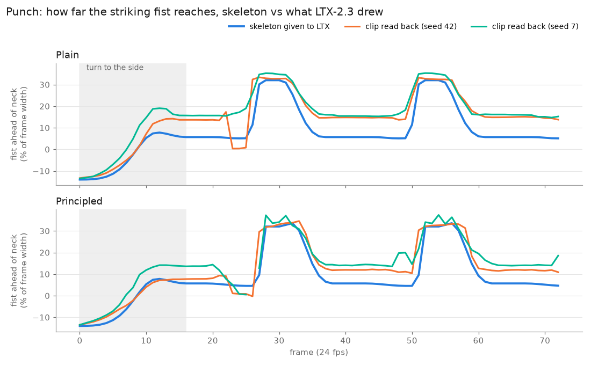
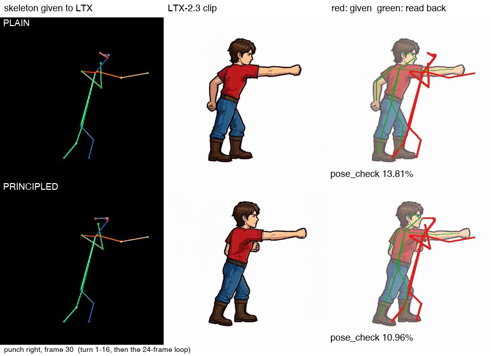
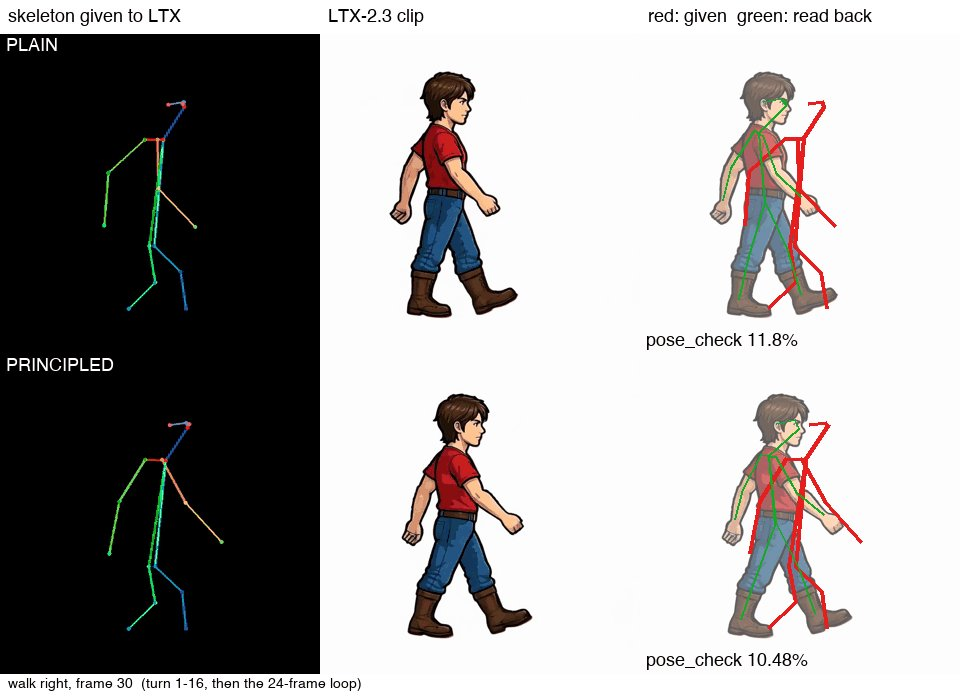

# Does LTX-2.3 follow the principled skeletons? Plain against principled, on the walker

pipeline#30, 2026-11-28, MACBOOK-STEPHEN. pipeline#8 built the animation principles into the code-made cycles
(`skeleton.ts`; the wind-up, the hold, the overshoot, the drop after each step). This run asks whether the video
model follows them as closely as it follows pipeline#14's plain cycles.

## How it was run

- **Animate as it runs for a character** (`scripts/animate.py --stem walker --cycle attack|walk --facing right`):
  the cycle is made fresh for the walker's own rig by `skeleton-cycle.ts --pose-only`. The plain runs were the
  same call with `--plain` added to that one `skeleton-cycle.ts` call (a wrapper script, not a code change).
  Each made skeleton was checked against `skeleton-cycle.ts --plain` output: identical.
- Same everything else: the walker's drawn front picture, its own side view as the second guide (Animate's
  default since pipeline#26, mirrored to face right), the cycle prompt, 73 frames at 24 fps, 704 px.
  Seeds 42 and 7 for each: eight clips.
- A scratch copy of `out/walker`, so the real asset got no new 2D Versions.
- LTX-2.3 distilled 1.1 q8 with the Union-Control IC-LoRA, from `~/projects/video-trials` via the
  `PIPELINE_LTX_*` overrides; `bin/bodypose` built from `scripts/bodypose.swift`. 58–85 s of LTX per clip.

## pose_check

Apple Vision's skeleton read back from the clip, against the skeleton given to LTX, in percent of the frame's
width (`anim.json` `pose_check`; lower is closer). Two more columns take the frames after the turn only (17–72),
and **drift removed** moves each read-back frame so its middle sits on the given skeleton's middle: it measures the
pose, not where on the screen LTX put the character.

| clip | all joints | moving joints | loop (17–72) | loop, drift removed | moving, drift removed |
|---|---:|---:|---:|---:|---:|
| punch plain, seed 42 | 13.81 | 13.09 | 15.24 | 7.24 | 8.30 |
| punch principled, seed 42 | **10.96** | 10.94 | 11.77 | 6.05 | 6.11 |
| punch plain, seed 7 | 14.62 | 13.98 | 15.68 | 7.18 | 7.93 |
| punch principled, seed 7 | **12.04** | 10.84 | 12.85 | 6.16 | 6.06 |
| walk plain, seed 42 | 11.80 | 11.48 | 13.20 | 6.77 | 7.35 |
| walk principled, seed 42 | **10.48** | 11.39 | 11.52 | 6.91 | 7.56 |
| walk plain, seed 7 | 11.74 | 10.47 | 13.04 | 5.18 | 3.99 |
| walk principled, seed 7 | **10.14** | 9.89 | 10.99 | 4.88 | 3.38 |

Vision found a skeleton in all 73 frames of all eight clips.

## What it shows

- **The punch: LTX follows the principled one more closely**, in both seeds, and still does with the drift taken
  out (moving joints about 8% → 6%). Both versions hit the full reach of the strike. With the principled skeleton,
  LTX keeps the guard nearer the skeleton's and draws the first wind-up pull-back in both seeds; with the plain one
  it does so in seed 42 only. The overshoot shows as a small spike in seed 7. Neither follows the second loop's
  wind-up.
- **The walk: level on the pose.** With the drift taken out, the two are within a few tenths of a percent, one each
  way. The principled walk's better pose_check comes from LTX keeping that walker closer to where the skeleton
  stands.
- **Most of the error in every clip comes from two things the versions share.** LTX drifts the walker 8–14% of the
  frame to the left during the turn and keeps it there. It also keeps the drawn picture's proportions: Vision puts
  the hips at about 0.52 of the frame's height, where the skeleton made from the walker's sprite-stack rig has them
  at 0.64–0.66. That is a short-legged body against a long-legged drawing.

Frame 30 of each (just after the first strike). Plain on top, principled below. Columns: the skeleton given to LTX,
the clip, and the clip with the given skeleton (red) and the one Vision read back (green).

The full side-by-side GIFs are on the pipeline#30 card (about 5 MB each, so they are not kept in the repo). The
eight clips with their `anim.json`, control and read-back skeletons, the GIFs and the scripts that made them and
these numbers are in `out/_experiments/pipeline-30-principles-ltx/` on MACBOOK-STEPHEN (not in git).
