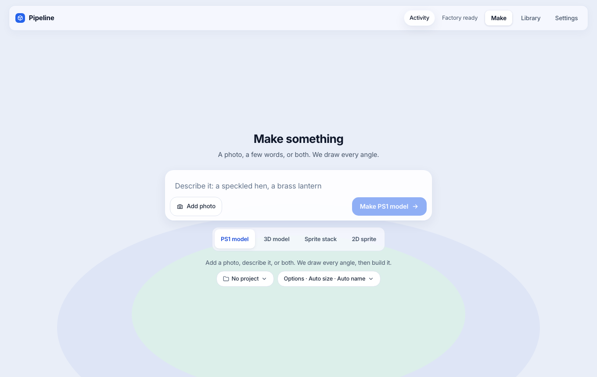
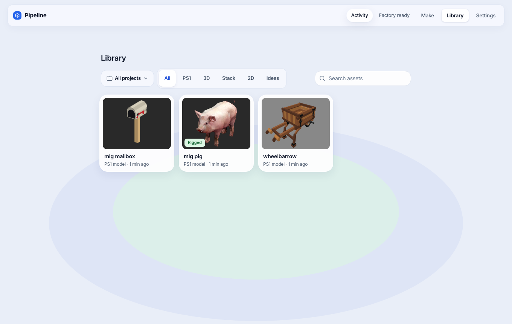
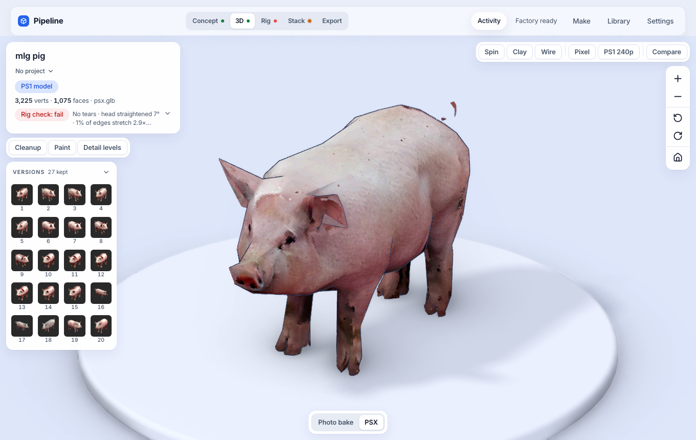
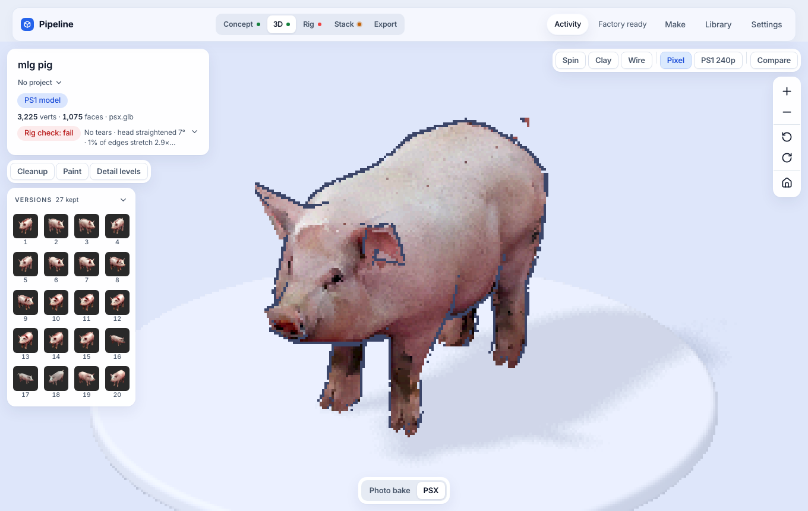
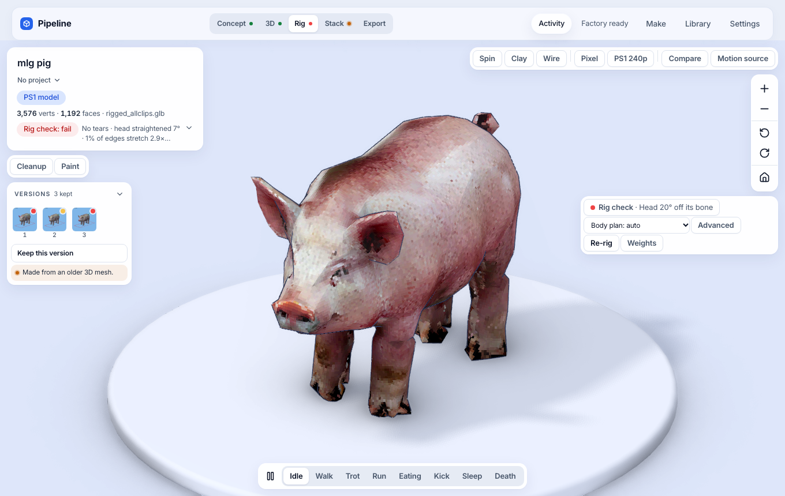
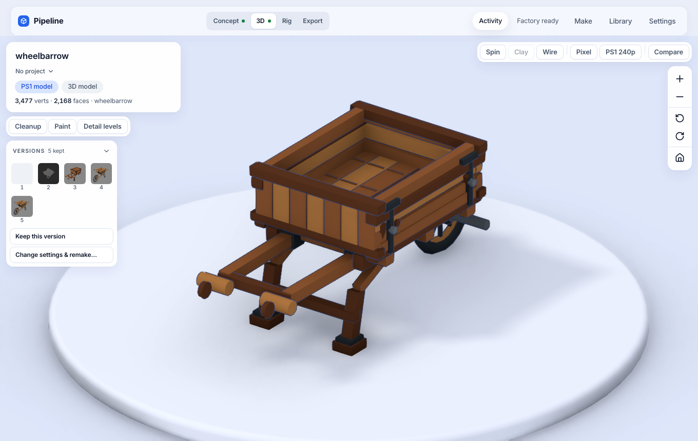
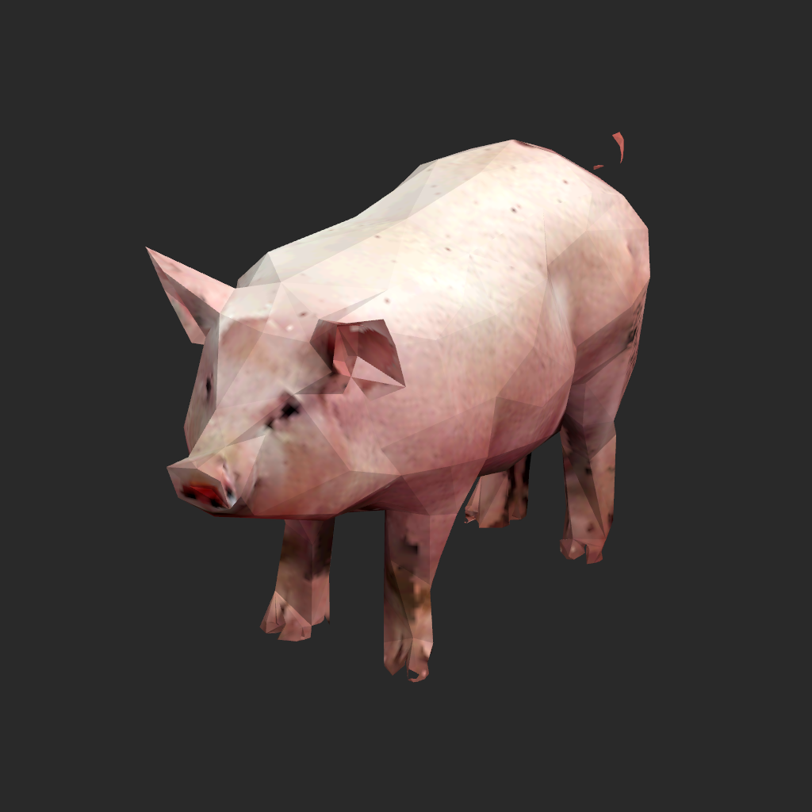
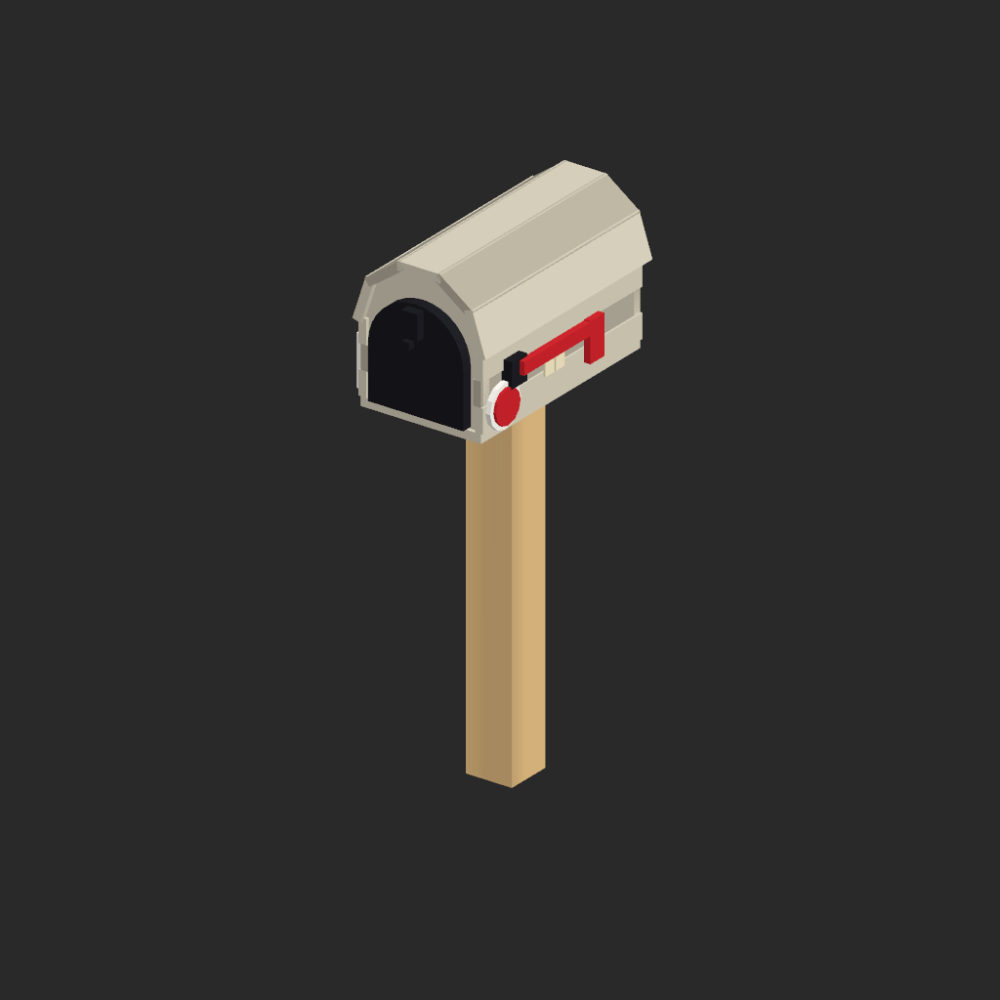
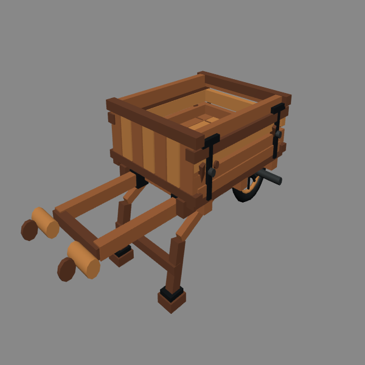
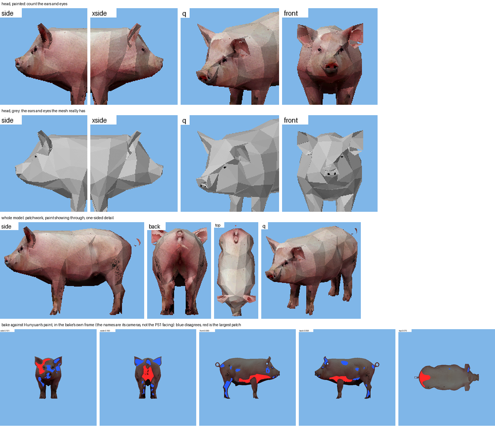

# Where we are (checked 2026-11-16)

A read-through of the repo after about two weeks away. Nothing here was changed, pushed, merged or deleted. The last
commit is 2026-11-03 (#360); the last branch activity is 2026-11-08 (the car experiment and PR #8 below).

The short version:

- **The pipeline works end to end.** A photo or a few words becomes a PS1-budget model, a 3D model or a sprite stack,
  and animals and people can be rigged. The desktop app and an agent "workbench" (Claude driving the pipeline over
  MCP) both sit on top of it.
- **One model, the pig, took most of the last two weeks of work (10-24 to 11-03).** It still fails three of its own
  checks.
- **Hard-surface props (mailbox, wheelbarrow, car) are the unsolved class.** The code-built route for them was removed
  on 2026-11-09 because you found it useless. A new one (car from parts) is on a branch, unmerged.
- **GitHub is not where the work is.** GitHub `main` is still at the 2026-10-21 snapshot; the real line is `mokei-ui`,
  157 commits ahead of it, with no open PR. The "117 commits on local main" in the card are the old private history,
  not new work.

## 1. What the pipeline is for

A local, no-cloud asset factory on an Apple Silicon Mac (MLX, no Meshy). You give it a picture and/or words and it
makes game assets, aimed at the MLG Farming PS1-look test game (s&box):

| You pick | You get |
|---|---|
| **PS1 model** | about 1,200 flat-shaded triangles wearing the photo itself in a 256 px atlas, as `.obj` + `.png` and a `psx.glb` |
| **3D model** | a painted mesh (Hunyuan3D shape, Hunyuan or TRELLIS.2 paint), with detail levels |
| **Sprite stack** | horizontal slices of the model as a sheet, "how we ship" per the README |
| **2D sprite** | a cut-out piece sheet with names, sound and voice lines |

How one make runs: the app **draws four views** of the subject (from your photo or from words), builds the shape from
those views, paints it, bakes the photo on top, then cuts the PS1 version. A **review** step checks the result
(ears, eyes, legs as separate pieces, paint patchwork, triangle budget) before it is shown. Animals and people can
then be **rigged** (skeleton, learned skin weights, library clips, FBX for s&box). Everything is kept as numbered
takes per asset in `out/<stem>/takes/`.

Two ways to drive it, same factory underneath: the **desktop app** (Make, Library, then Ideas / Concept / 2D / 3D /
Rig / Stack / Export per asset) and the **workbench**: an MCP server on `:8768` where Claude makes, measures, fixes
and shows assets, guided by `scripts/workbench/playbook.md` (every critique of yours became a check in the review).

## 2. What works today

The app, headless screenshots of the built frontend against a throwaway copy of `out/` (no model was loaded, no
window opened):

| Make | Library |
|---|---|
|  |  |

(The Library shot says "1 min ago" on every card only because the screenshots read a fresh copy of `out/`.)

The pig in the app: its 3D screen (the PS1 cut, photo baked, with its 27 kept versions), the same in the Pixel look,
and its Rig screen with the clips. The wheelbarrow's 3D screen is at the end.

The three models in `out/` (the only ones left; all are PS1 models):

| Pig (generated from a photo, TRELLIS.2 paint, rigged) | Mailbox (code-built, the removed route) | Wheelbarrow (generated: Hunyuan3D-2mv from front and back) |
|---|---|---|
|  |  |  |

The review sheet the pipeline wrote for the pig (it tells you what is wrong with it, see section 4):

Working, as of the last commit:

- **Make flow** for PS1, 3D, sprite stack and 2D, with honest progress, takes, Compare, projects, Export.
- **Photo as reference**: every 3D make draws all four views from the photo; shape from front and back when only the
  sides are drawn wrong.
- **Paint**: Hunyuan, or TRELLIS.2 (`--paint trellis`, added 2026-10-29); photo bake per triangle, with a
  `--flat-paint` fix for TRELLIS.2's plain paint.
- **PS1 cut**: welds near-duplicates, caps holes, keeps legs and ears, publishes `psx.glb`.
- **Rig**: body plans (person, four legs, many legs, bird), weight painting panel, `rig_review`, `rig_scrub`
  (new 2026-11-03), clips with a floor pass.
- **Workbench**: look, measure, compare, mesh edits (thicken legs, trim belly...), review before showing, `show`
  opens an asset in the app with a before and after.
- **Tests**: 793 passed, 12 skipped, 0 failed (`pytest tests`, 5 minutes, run on the local `mokei-ui` checkout).

## 3. What was in progress at the stop

In order, newest first:

1. **2026-11-08/09, hard-surface props, second attempt.** PR #8 (merged into GitHub `mokei-ui` on 2026-11-09)
   **removed the code-built route** (Claude writes a Three.js page, a headless browser exports it). Its commit says
   "the person finds the non-generated hard-surface route useless." That route had been added days earlier (#360,
   2026-11-03); the playbook says the image-to-3D models (Hunyuan, TRELLIS.2, GLB-Coder) lost to it on hard-surface
   props (#351). The mailbox in `out/` came from it. The wheelbarrow, made the same day, did not: it is a plain
   Hunyuan3D-2mv make, built from front and back because "the side views disagree with the front".
2. **2026-11-08, "car from parts" (#1127), branch `racecar-1127`, pushed, no PR.** Four small scripts:
   `draw_parts.py` (draw a body picture and a wheel picture), `edit_part.py`, `assemble_car.py` (one body + one wheel
   model assembled into a car with four named wheels), `viewer_shots.py`. No sign it was ever run end to end: there
   is no car in `out/`.
3. **2026-11-03, #355 rig scrub, #356 viewer defaults, #360 code make.** All three are on GitHub `mokei-ui` (#360's
   route was then removed, above).
4. **2026-10-29, the pig and TRELLIS.2 paint.** Five commits to get TRELLIS.2's plain paint, its tail, nostrils and
   cut holes right on the pig. This is the last model-quality work on a generated animal.
5. **2026-10-24 to 25, review and critique loop.** The review step, the bake fixes, the playbook, the "close holes
   and carve parts" tools. Rule 1 of the playbook: make **one** model, wait for your critique, improve the
   pipeline, make the next. The pig is that one model.

## 4. What is unfinished or broken

- **The pig fails its own checks.** The review says "fix: pieces, paint": a leg is its own pinched piece (3 pieces,
  limit 1) and the paint disagrees with the bake in a belly patch (0.16, limit 0.08). The rig check also fails
  ("head 20° off its bone", 1% of edges stretch 2.9x), and its rig is marked "made from an older 3D mesh". The tail is a
  floating speck in the picture above. The triangle budget passes (1,075 of 1,300).
- **Hard-surface props have no working route.** The one generated prop in `out/` (the wheelbarrow) is blocky, with
  its handles and wheel hard to read; the code-built route was removed; car from parts is unproven. Vehicles and
  props also can't be rigged yet (README).
- **Docs are stale.** `PLAN.md` still describes the September pipeline (Hunyuan mini, "Next: character A-pose") and
  never mentions the workbench, TRELLIS.2 or the app flow. The local README still has the removed code-model
  paragraph (GitHub's does not).
- **The local checkout is 2 commits behind GitHub `mokei-ui`** (the code-model removal and its merge). It still has
  `code_model.py`.
- **`out/` holds only three assets** (6.8 GB, nearly all the pig's takes). The radio, operator and cow/farmer
  examples the README and `examples/` talk about are not there.
- **Leftovers of the setup:** `/Applications/Pipeline.app` was set on 2026-10-16 to launch the checkout's
  `desktop/bin/pipeline`; I did not check it still runs.
- Not checked: whether any model-heavy path (draw, shape, paint, rig) still runs end to end today. I loaded no
  models, per the card.

## 5. Loose ends in the repo

### The 117 commits

`main` in `~/projects/ai-asset-pipeline` is **not** the real line. It is the old private history, frozen at
2026-10-17 (PR #25, the MLG PS1 work), 117 commits ahead of GitHub `main` because GitHub's history starts again on
2026-10-21 with one squashed "ai-asset-pipeline: a local image-to-3D and 2D asset pipeline" commit. Their *content*
is on GitHub: `main` and the `pub/*` branches differ by 26 files (the open-source cleanup). Nothing new is trapped
in them. They are the only copy of the fine-grained history, so keep `main` as an archive and do not push it.

The real working branch is `mokei-ui` (checked out in the repo; GitHub: `3d8c1e0`, 2026-11-09). It is **157 commits
ahead of GitHub `main`**, none of it merged there, and there are **no open PRs** (PRs 1 to 8 are merged or closed;
PR #8 merged into `mokei-ui`, not `main`). Everything on local `mokei-ui` is already on GitHub. That is the real
gap: GitHub's front page shows the 2026-10-21 state.

### 25 worktrees and 48 branches

The card counted 24 worktrees and 47 branches; the extra one of each is this card's own folder and branch
(`hearth/pipeline-1`). The 25 worktrees are the main checkout, this card's folder, and 23 others. All are clean apart from mode-only changes
(11 files the app build marks executable, in 8 of them) and untracked links to `bin/`, `weights/` and `.venv`
(plus a built `desktop/desktop` in `aap-open-source`); none holds unsaved text changes. Of the 48 branches, 30 are landed, 3 are worth keeping and 15 are old private history.

| Verdict | Branches (worktree in brackets where one exists) |
|---|---|
| **Landed, safe to drop** (30) | **In GitHub `main` (10):** `pub/app-coherence`, `pub/rigging`, `pub/rig-tools`, `pub/quality-mv`, `pub/photo-views`, `pub/mokei-ui` [`~/projects/aap-open-source`], `public-main`, `worktree-wf_c6167320-f6c-1`, `worktree-wf_dff7a201-b18-2`, `hearth/pipeline-1` [this card's folder] |
| | **In GitHub `mokei-ui` (19):** `compare-view` [`wf_c6167320-f6c-1`], `finished-models-only` [`wf_dff7a201-b18-2`], `racecar-1126` [same commit as local `mokei-ui`], and 16 `worktree-wf_*` branches, each with its own worktree: `50b34c8e-981-1`, `661ef173-836-2` to `-6`, `6dbd0f7e-f6e-5`, `c058cc29-b5d-1` to `-3`, `c6167320-f6c-2`, `dff7a201-b18-1` and `-3`, `f22e16dd-bf4-1` to `-3` |
| | **Merged by PR #8 (1):** `remove-code-model` [`card-1128`] |
| **Worth keeping** (3) | `mokei-ui`: the working line, checked out in the main repo; fast-forward it by 2 |
| | `racecar-1127` [worktree `racecar-1127`]: unmerged car-from-parts experiment, pushed |
| | `main`: the old private history, as an archive only (see above) |
| **Old private history, safe to drop** (15) | Content is on GitHub. They are older steps of one chain: `main` → `rigging` → `rig-tools` → `quality-mv` → `photo-views` → `slice2-*`. `open-source`, `quality-mv`, `rig-tools`, `rigging`, `photo-views` [`~/projects/aap-photo-views`]; the five `slice2-*` (export, flat, ideas, settings, takes: the build-up of the new UI, which `mokei-ui` carries about 20,000 lines past); `worktree-wf_e05f2124-5b8-1` to `-5` (all equal `main`) |

Worktrees to remove if you tidy: 22 (everything except the main checkout, this card's folder and `racecar-1127`).
Two cautions. Removing a worktree folder should only remove its links to `weights/` and `.venv`, not the 90 GB they
point at; I did not test that. And `aap-open-source` holds one untracked built binary (`desktop/desktop`).

How the "old private history" verdicts were checked: the lines that exist only in the `slice2-*` branches are the
retired classic page (`desktop/frontend/index.html`, 6,900 lines, plus `stack-lab.js` and `rig-inspect.js`) and files
since renamed (`TakesStrip.tsx` became `VersionsPanel.tsx`); `open-source`'s files (`LICENSE`, `NOTICE`, the Inter
licence text) are identical on `mokei-ui`, and its only other change deletes `in/mlg/cow.jpg`, which the public
line leaves out on purpose. One reason to keep `main` private: it still holds that cow photo.

## 6. Next steps to choose from

1. **Catch GitHub up.** Open a PR `mokei-ui` → `main` (157 commits), pull the 2 commits into the local checkout, and
   rewrite `PLAN.md` and the README top to match what exists. Cheapest, and it makes the repo describe itself.
2. **Pick a hard-surface prop route.** Either run car from parts end to end on one car and judge it, or decide
   props stay out of scope and say so in the README. Right now the mailbox and the wheelbarrow are the evidence that
   nothing works well.
3. **Finish the pig and re-prove the chain on it.** Fix the three failing checks (leg piece, belly paint, head bone),
   then run the pig's photo fresh through Make → PS1 → Rig → Export on the Mac with timings, to find out what
   broke while nobody was looking. Then make the next MLG animal under the playbook's rule.
4. **Tidy the worktrees and branches.** Remove the 30 landed and 15 old-history branches and their 22 worktrees
   in one go once you have read section 5, keeping `main` as an archive.

## How these pictures were made

The repo has no `bun run show`. The app screenshots are headless Chromium (no window, no focus) against the built
frontend (`desktop/frontend/dist`, built 2026-11-03) with a throwaway factory on port 47211 reading a copy-on-write
clone of `out/`, so the real `out/` was untouched. The model pictures are the previews the pipeline already wrote
(`out/*/preview.png`, `out/mlg-pig/workbench/review/sheet.png`). `git` and `gh pr`/`gh api` reads were the only
GitHub access. Running the 793 tests in the real checkout left only ignored caches changed (`scripts/__pycache__`)
and no file under `out/`; `git status` there stayed clean.
